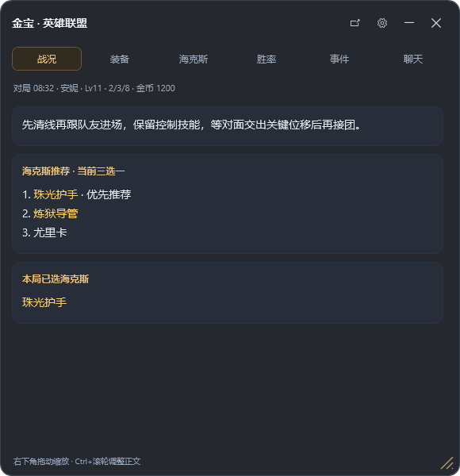
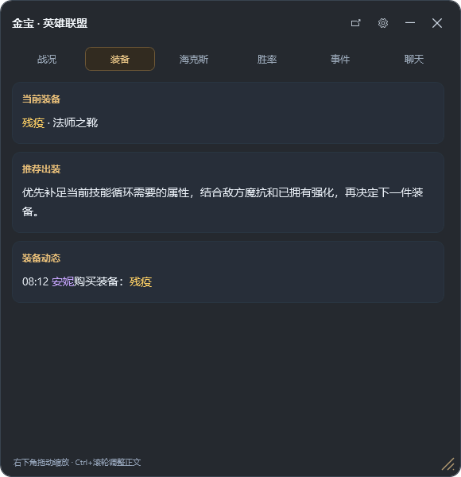
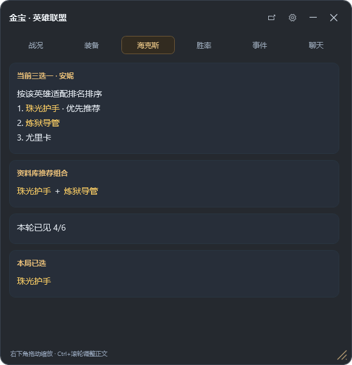
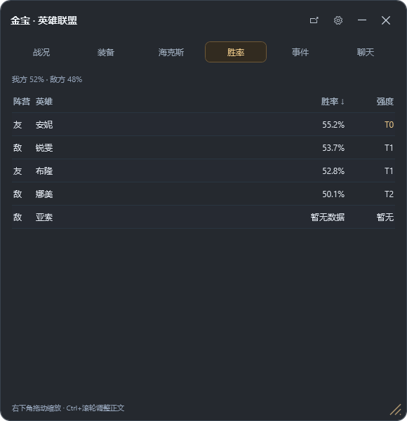
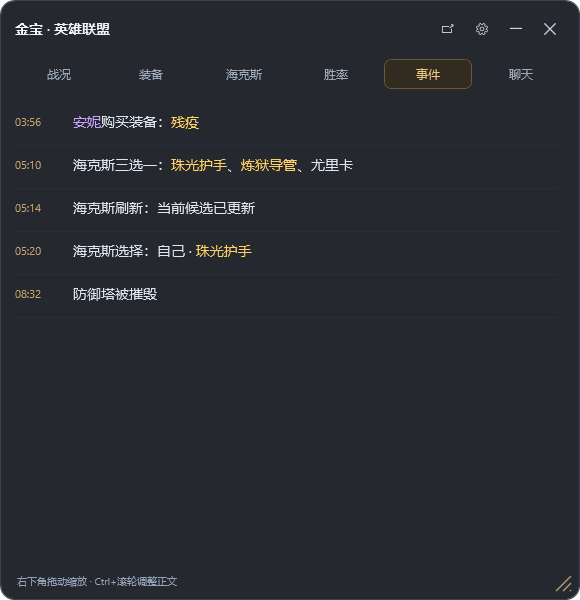
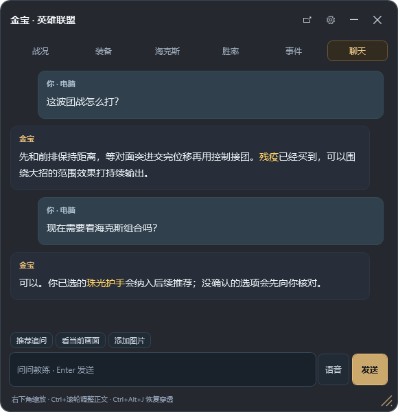

# 金宝游戏教练

读取游戏日志，在桌面悬浮窗中提供对局策略建议。当前适配 **英雄联盟（重点为海克斯大乱斗）**和通过 Android 手机采集的**王者荣耀**。聊天、工具调用、会话与上下文管理复用 DSH Desktop。

[下载 Windows 版](https://github.com/YuanCao1996/dsh-jinbao-desktop/releases/latest/download/jinbao-desktop-windows.zip) · [金宝官网 / 手机 App](https://www.jinbaoai.top/#download) · [版本与更新记录](https://github.com/YuanCao1996/dsh-jinbao-desktop/releases)

## 能做什么

| 功能 | 使用方式 |
|---|---|
| 对局建议 | 根据当前英雄、阵容、装备、海克斯和关键事件提供建议，在战况页查看。 |
| 海克斯辅助 | 三选一面板出现时识别候选，按当前英雄的资料排名排序；查看推荐组合。识别不确定时可通过选项确认。 |
| 出装建议 | 结合本局状态、敌方装备和已选海克斯提供出装参考。 |
| 英雄胜率 | 查看敌我及选人阶段可见备选英雄的胜率、强度和团队估算，便于比较。 |
| 对局聊天 | 针对当前对局提问，与自动教练共用本局 Agent 会话；可按需查询日志、搜索攻略及调用已配置工具。 |
| 多种显示方式 | 大框浏览完整页面，窄条使用字幕或滚动显示，也可切换静默小球。 |
| 手机查看 | 用配对码将电脑对局同步到金宝 App，并从手机向电脑 Agent 提问。 |
| 更新与设置 | 网页查看账号、可用额度、版本和更新状态，配置模型及维护安装。 |

> 数据、识别和模型能力会影响结果；缺少资料时会显示“暂无数据”，胜率与团队估算不代表本局获胜概率。通用游戏支持仍在实验阶段，当前下载版不承诺支持所有游戏。

## 第一次使用

需要 Windows 电脑、网络连接，以及 DSH Desktop。普通用户使用发布包即可，无需安装 Node.js 或执行开发命令。

1. [下载金宝 Windows ZIP](https://github.com/YuanCao1996/dsh-jinbao-desktop/releases/latest/download/jinbao-desktop-windows.zip)，**完整解压**到一个固定目录，不要在压缩包内直接运行。
2. 安装 [DSH Desktop](https://deepseek.com/harness/)，再双击金宝目录中的 `开始使用.cmd`。首次配置如提示退出 DSH，请先保存工作并正常退出，再等待金宝继续。
3. 启动后出现悬浮窗，并自动打开设置网页。默认选择**金宝官方服务**，按网页提示使用邮箱验证码登录，查看账号状态和可用额度。也可在设置里改用自己的模型 API Key。
4. 启动游戏。LoL 在本机运行时自动检测和采集；悬浮窗等待对局数据，无需手动选择进入游戏。
5. 以后双击桌面“金宝”快捷方式，或原目录中的 `开始使用.cmd`。请保留解压目录。

> **正在开发的安装简化：**源码启动器已加入“缺少 DSH 时自动下载官方安装器、校验签名、显示进度、取消和重试”，完成官方安装界面后自动继续配置。该流程尚未发布到新版 ZIP；使用现有下载包时仍按上面步骤安装 DSH。DSH 如有自身的初始化或认证提示，也需按宿主界面完成。


**两种模型使用方式：**官方服务使用金宝账号的可用权益；自有 Key 使用你配置的模型服务。设置网页显示的金宝剩余额度不代表自有 Key 的厂商余额。攻略数据检索权限与模型 Key 独立，配置 Key 不会自动获得所有检索数据。

王者荣耀采集另需 Android 手机：从[金宝官网](https://www.jinbaoai.top/#download)下载统一 App，按[使用指南](docs/QUICKSTART.md)连接并授权 USB 调试、开启游戏采集。只玩电脑 LoL 无需连接手机，默认不启动 ADB。

### DSH Desktop 安装与配置

DSH Desktop 是金宝的运行宿主，负责运行扩展、Agent、会话和工具。金宝的模型服务在金宝设置网页配置。

1. 打开 [DSH 官方下载页](https://deepseek.com/harness/)，下载适合 Windows 的安装程序，按安装向导完成安装。建议保留默认安装位置与开始菜单快捷方式，便于金宝自动找到程序。
2. 如安装后自动打开 DSH，按其界面提示完成必要的首次初始化。若 DSH 自身要求认证，请按宿主要求处理；金宝邮箱登录不能替代 DSH 自身认证。
3. 首次配置金宝前，保存 DSH 中的工作并正常退出 DSH。完整解压金宝，双击 `开始使用.cmd`，由金宝安装扩展并重新启动宿主。
4. 金宝会自动配置教练扩展、日志目录及“金宝游戏模型”路由。**不需要手动编辑 DSH 的 YAML，也不需要在 DSH 中另外创建金宝会话或重复填写模型 Key。**已有配置文件在修改前会备份。
5. 在自动打开的金宝设置网页配置模型服务：
   - **官方服务（默认）：**用邮箱验证码登录，确认账号可用、模型权益与额度充足。
   - **自有 Key：**“模型服务 → 调用方式 → 使用自己的 API Key”，填写模型厂商提供的 **OpenAI 兼容 API 地址、模型 ID、API Key**，点击“保存设置”。Key 保存在本机。
6. 检查网页中的教练服务、登录与模型状态，再进入游戏。悬浮窗显示等待游戏只代表界面已启动；能收到本局建议或聊天回答，才代表模型调用链路可用。

**安装后找不到 DSH：**先从开始菜单打开一次 DSH，返回金宝重试；仍失败时在金宝设置网页“维护与诊断”检查状态。已有 DSH 和金宝的电脑通常只需启动金宝，无需每次重复安装或配置。

**配置保存位置：**默认在用户目录的 `.dsh` 下；金宝状态位于 `.dsh/jinbao`，宿主扩展配置位于 `.dsh/profiles/desktop/cordis.patch.yml`。设置了 `DSH_HOME` 时以该目录为准。普通用户无需手动修改这些文件。


## 悬浮窗怎么用

以下为 **2026-10-21 桌面程序实际渲染截图**，使用界面验收的演示对局数据，不代表实战识别效果或实时推荐。后续版本的细节可能有所变化。

| 战况：对局建议与当前状态 | 装备：当前装备与推荐 |
|:---:|:---:|
|  |  |
| **海克斯：候选排名与推荐组合** | **胜率：英雄胜率与强度** |
|  |  |
| **事件：关键对局记录** | **聊天：围绕当前对局提问** |
|  |  |

| 页面 | 显示内容与用途 |
|---|---|
| **战况** | 当前对局状态、游戏已进行时长及动态策略建议，快速了解下一步。 |
| **装备** | 已读取的装备信息和推荐出装；推荐需要可用的模型与对局数据。 |
| **海克斯** | 选择面板出现时显示候选排名，推荐组合常驻。候选、刷新或最终选择可能受画面识别限制；不确定时按提示确认。 |
| **胜率** | 英雄胜率、T0 / T1 等强度，按英雄胜率降序排列；展示双方团队估算。隐藏玩家名与场次，未知数据置后。 |
| **事件** | 装备购买与变化、海克斯候选/刷新/选择、推塔等关键事件，最新消息追加到底部；普通击杀等信息不展示。 |
| **聊天** | 输入本局问题，例如“这轮海克斯怎么选？”“针对对面的装备，下一件出什么？”；查看回答及执行状态。 |

- **移动与缩放：**拖动标题栏移动，拖动右下角手柄调整大小；尺寸会保存。
- **阅读：**内容区滚动浏览；按住 `Ctrl` 滚轮调整正文大小。字体和背景透明度在“设置 → 外观”调整。
- **切换显示：**通过模式按钮或“设置 → 显示与播报”选择大框、字幕、滚动或静默小球。字幕与滚动适合边玩边看，大框用于查看完整信息和聊天。
- **收起与退出：**收起后点击小球展开；`×` 或托盘“退出”关闭金宝及本次采集，DSH 保持运行。
- **打开设置：**悬浮窗设置菜单进入账号与模型设置；`Ctrl+Alt+J` 切换完整交互，聊天自动进入交互模式。

## 用手机查看电脑对局

电脑和手机无需使用同一个登录账号，也无需 USB 连接。


配对码有效期为 5 分钟，确认后失效。电脑与金宝需要保持在线；连接保存后可自动恢复，网页可暂停同步。手机 App 从[官网](https://www.jinbaoai.top/#download)下载。更多说明见[手机配对指南](docs/QUICKSTART.md#手机查看电脑对局)。

## 更新与常见问题

从 0.1.10 起支持自动检查更新；启动时及运行中每 6 小时检查，并在后台下载和验证。在**设置网页**查看当前版本、检查更新、下载进度和安装提示。新版本就绪后按提示安装；先保存工作并正常退出 DSH，金宝再完成切换。选英雄或对局期间不能安装更新。

更新保留登录和用户设置。0.1.9 及更早版本需先手动下载新版；DSH Desktop 与手机 App 使用各自的更新方式。

| 遇到的问题 | 先检查这里 |
|---|---|
| 没有建议或聊天失败 | 设置网页的登录、模型和教练服务状态；在“维护与诊断”查看错误。 |
| 胜率一直待查询 / 暂无数据 | 检查检索服务与网络；尚无对应英雄或模式数据时无法显示排名。 |
| 海克斯未识别 | 保持游戏与选择面板可见，检查 Windows 中文文字识别组件；也可在聊天中输入候选。 |
| 悬浮窗被游戏遮住 | 尝试无边框或窗口模式。 |
| 登录后仍无法调用官方模型 | 在设置网页检查模型权益和剩余额度；也可配置自己的 API Key。 |
| 启动或更新失败 | 进入设置网页“维护与诊断”；网页打不开时参考包内 `tools/desktop-release/menu.cmd`。 |

[完整使用与排障](docs/QUICKSTART.md) · [SHA-256 校验文件](https://github.com/YuanCao1996/dsh-jinbao-desktop/releases/latest/download/SHA256SUMS.txt)

## 开发与项目边界

Windows、Node 24 LTS（构建最低 24.22.1）：

```powershell
npm ci --ignore-scripts --legacy-peer-deps
npm test
$env:JINBAO_BUILD_ADB_DIR = '你的 Android platform-tools 目录'
npm run build -- workspace/client-releases/local
```

结构与开发说明见[开发文档](docs/DEVELOPMENT.md)。云端检索服务与完整数据库不包含在本仓库中。

许可见 [LICENSE](LICENSE)，第三方运行时许可随包保留。安全问题请参阅 [SECURITY.md](SECURITY.md)；使用与运营边界见[合规说明](docs/COMPLIANCE.md)。
